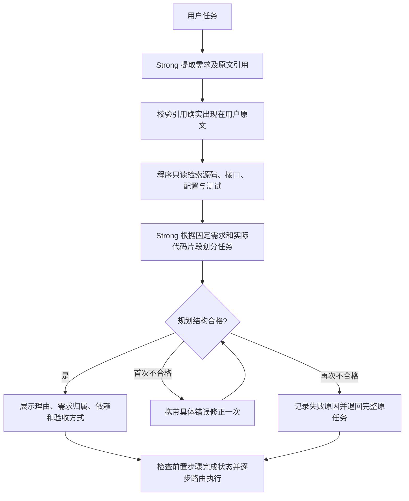

# 子任务规划与校验

本轮实现先依据功能与依赖划分任务，再为每步补充带依据的初步复杂度分析，最后逐步调用 Jev 独立判断难度。规划由配置的 Strong 模型完成；Jev 不负责生成拆分方案。三档指向同一模型时，规划流程仍然成立，但不能比较档位能力与成本。

## 拆分原则

1. 一步交付一个能够说清楚、能够验收的能力，例如“按编号完成事项并持久化状态”。不要只写“修改 storage.py”或“实现功能”。
2. 同一能力紧密关联的源码、接口、配置与测试尽量放在一起。修改多个文件不自动意味着需要拆成多步。
3. 只有接口明确、可以分别验收的工作才拆开。后续步骤通过显式声明的成果契约使用前面步骤的结果。
4. 功能、错误处理、测试和文档以用户明确要求为依据，不额外添加产品功能。实现需求所必需的内部辅助工作可以随所属功能一起交付。
5. 简单任务保留一步；最多六步是当前执行预算，不能解释为任务的最佳粒度。规划不根据要使用 Small 模型而强行拆分。

这些原则通过模型提示与结构字段共同约束。程序不能单靠文本判断边界在语义上是否合理。

## 处理顺序



需求提取结果在后续规划和修正中保持固定，避免通过删除需求绕过覆盖检查。每个需求的 `sourceQuote` 必须是原始任务中的连续引用，允许归一化空白。该规则只能证明引用出处，不能证明提取的需求清单完整或理解正确。

已有项目先读取实际文本片段再生成规划。空目录会显式记录没有已有代码，不伪造接口或测试。代码片段作为待分析数据传给规划器，不执行其中的命令。

## 代码阅读预算

`src/repository/inspection.ts` 优先使用 Git 的已跟踪和未忽略文件清单；普通目录使用只读遍历。通过任务、需求中的词语与文件路径、源码内容匹配筛选，尽量包含源码、测试和项目配置三类依据。这是确定性的局部检索，不是完整代码库分析。

- 最多保留 2000 个候选文本文件；普通目录最多遍历 10000 个目录项。
- 最多扫描 160 个候选文件，每个只读前 64 KiB。
- 最终提供最多 12 个片段，每段最多 100 行、4000 字符。
- 跳过依赖、构建、缓存、隐藏目录、常见凭据文件和二进制；读取前检查实际路径在目标工作区中，跳过符号链接。
- 不给规划会话任何文件修改、shell 或其他工具权限，不运行项目代码或测试。

证据记录 `id`、相对 `path`、`startLine`、`endLine`、实际提供的 `excerpt` 及其 `sha256`。哈希针对脱敏后的片段文本，不代表整个文件。达到预算时在 `inspection.truncated` 与 `notes` 中说明。语义相关性仍可能不足，片段也可能未包含实际需要修改的代码。

## 规划结果

`plan.requirements` 保存需求 ID、说明和原文引用。`plan.rationale` 说明整体拆分和执行顺序。每个 `plan.subtasks` 元素包含：

| 字段 | 含义 |
| --- | --- |
| `id` | 按执行顺序编号的 `step-1`、`step-2` 等 |
| `description` | 完成本步后具备的能力 |
| `requirementIds` | 本步负责的需求 ID，至少一项 |
| `dependsOn` | 必须先完成的步骤 ID |
| `inputs` | 本步使用的前置成果或已有接口 |
| `outputs` | 本步交付的能力或接口，至少一项 |
| `expectedFiles` | 预计创建或修改的工作区相对文件路径，是实施线索 |
| `acceptanceCriteria` | 应满足的具体结果 |
| `verification` | 测试命令、调用示例或具体检查方法 |
| `rationale` | 本步边界及紧密关联修改放在一起的理由 |
| `evidenceIds` | 本步实际引用的已读代码片段 |
| `complexityHint` | 可选初判 `easy / medium / hard`，不直接决定档位 |
| `complexityFactors` | 可选复杂度分析，区分代码事实、实现假设和未知情况 |

依赖前面步骤时，`inputs` 至少包含该步骤 `outputs` 中的一项，作为可检查的成果契约。程序只检查归一化后的文本匹配，接口是否正确兼容仍由实施与验收判断。

## 复杂度分析与 Jev 的分工

规划器在确定功能边界后，说明完成这一步预计需要的工作。Jev 按 `src/core/decision.ts` 中的同一份 `CODING_DIFFICULTY_CRITERIA` 进行最终分类。程序校验字段结构、应用置信度回退并映射档位。分析不能成为先选档位再强行拆任务的理由。

每步可以额外返回以下字段（此处省略原有必需字段）：

```json
{
  "complexityHint": "medium",
  "complexityFactors": {
    "changeScope": "扩展用户接口层与认证组件，并增加接口测试",
    "dependencies": "需要已有用户查询接口；密码校验组件尚待确认",
    "integrationRisk": "保持现有用户查询接口兼容，处理认证失败路径",
    "uncertainties": ["已读片段未包含密码处理代码，无法确认是否已有校验组件"],
    "confirmedFacts": [
      {"statement": "用户仓储暴露 findByName 方法", "evidenceIds": ["evidence-1"]}
    ],
    "assumptions": ["预计可复用用户查询接口，实施时仍需确认输入输出契约"]
  }
}
```

`changeScope`、`dependencies`、`integrationRisk` 是非空文本；`uncertainties`、`assumptions` 是数组，没有对应内容时返回 `[]`。`confirmedFacts` 是事实数组，每项必须含非空说明和至少一个真实读取的代码 ID；空目录中应为 `[]`。以上代码事实只是格式示例，实际执行必须以本次 `inspection.evidence` 为依据。程序拒绝未知 ID、缺少引用的事实、无效标签或不完整分析对象；沿用规划结构修正一次、再失败则回退完整原任务的流程。

标签与分析均为可选字段。可只提供分析而不提供标签，也可全部省略；未拆分原任务的回退不会伪造分析。现有的规则路由和固定档位路由不会使用这些字段改变决定。

Jev 默认获得本步原始描述、交付成果、验收点、前置成果及最新工作区目录摘要，同时获得可用的分析和引用的代码片段。`planner_analysis.evidenceBasis` 为 `planning_snapshot`，明确这些片段取自规划阶段，前面步骤可能已改变实现。前一步拟提供的成果不等同于已确认存在的接口。提示词要求区分引用支持的声明和假设，并提醒初判可能错误；这种提示仍不能保证 Jev 不受标签影响。

分析字段放在独立上下文中，不拼入子任务文本，以便控制对照输入。CLI 的 `run` 与 `interactive` 均支持 `--jev-input baseline|hint|analysis`（默认 `analysis`，仅限 `--router jev`）。`baseline` 不发送分析或标签；`hint` 只增加标签；`analysis` 增加可用分析、标签和引用片段。三个模式共用分类标准与提示，同样计算规划费用；这是输入对照，不是省去规划成本的实验。

决策 trace 保存：

- `subtasks[].plan.complexityHint` / `complexityFactors`：规划器的原始初判和结构化分析。
- `subtasks[].decision.jevInput.mode` / `state`：实际构造的 Jev 输入模式和请求状态，不含鉴权头。API Key 缺失等请求前失败时，也保留准备使用的状态。
- `subtasks[].decision.plannerComparison`：有初步标签时记录 `hint`、Jev 原始 `jevDifficulty` 与 `disagrees`。即使 baseline 未发送标签，也可在运行后比较，但不能把该比较视为模型接收过标签。
- 请求失败时原始分类与分歧为 `null`；低置信度回退时保留 Jev 原始分类，最终 `tier` 可与分类对应档位不同。

例如初判 hard、Jev easy 且置信度 0.90 时，最终仍为 Small，`disagrees: true`；若置信度 0.59 则仍按现有规则选 Strong，不因为两者分歧新增升级。两份标签不取平均，置信度不相加。

引用检查只能证明片段确实读过，不能证明规划器的陈述被片段支持。局部阅读可能漏掉实现，历史片段也可能过时。后续应使用独立验收比较三种输入的质量、总费用与耗时，并将 Jev 输入增加的费用纳入统计；当前没有完成该对照，标签一致不代表分类正确。

## 程序能够检查什么

`src/app/plan-validation.ts` 会拒绝以下结构问题：

- 需求未分配、引用未知需求、一个子任务不对应任何需求。
- 重复步骤 ID、重复目标文本或重复交付成果文本。
- 依赖不存在、自身或后续步骤，或消费其他步骤的成果却未声明依赖。
- 声明依赖但未在 `inputs` 中消费任何对应 `outputs`。
- 缺少明确目标、边界理由、交付成果、预计范围、验收标准或验收方式。
- 预计文件使用绝对路径、路径越界或访问 `.git`；引用未实际读取的 evidence ID。
- 已提供代码依据却没有为某步引用任何依据。

同一需求可以由实现和测试步骤共同覆盖，同一文件也可以在不同步骤修改。这两类重叠会产生提示，不能一概判为错误。完全相同的文本可以被识别，换一种描述的语义重复仍可能漏检。

所有校验错误和修正次数保存在 `plan.validation`；即使第二次通过，也保留第一次失败原因。`status: passed` 只表示结构合格。若提取、读取或规划失败，则 `source` 和 `validation.status` 为 `fallback`，保留完整原任务作为一步，不能把它视为通过拆分质量检查。

每个模型请求最多等待 120 秒。需求提取一次，规划一次，只有规划结构不合格时最多额外修正一次；这些用量均计入规划费用。

## 执行与观察

CLI 显示规划阶段进度和完整规划摘要。Pi 状态栏显示当前规划阶段，聊天记录保留需求点、边界理由、依赖、产出和验收方式，随后才进入逐步路由。

两条入口使用 `src/app/task-plan.ts` 的相同执行提示。每步开始前检查前置步骤已成功结束，将这些步骤的实际执行摘要、成果契约、本步需求与验收方式传给 Pi。预计修改范围不会限制 Pi 必要的代码读取；实际改动仍写入每步 diff 和总 diff。

`verification` 当前是交给执行模型的验收指导，不会逐条当作 shell 命令自动执行。任务结束仍由既有自动评估器发现本地测试或构建命令并进行有限需求估计。执行失败后的动态重新规划、独立隐藏测试验收和拆分质量的系统实验尚未实现。

## 验证范围

单元测试覆盖需求原文引用、遗漏与重复、依赖顺序、成果契约、真实代码依据、只读扫描和空目录。通过本地模拟 API 验证 CLI 三档执行、多步衔接、修正一次、连续失败回退，以及 Pi 扩展中的规划展示、逐步调度与记录。

这些测试验证程序流程和结构规则，不衡量真实模型拆分质量，也不宣称已改善 Jev 的路由准确率。
